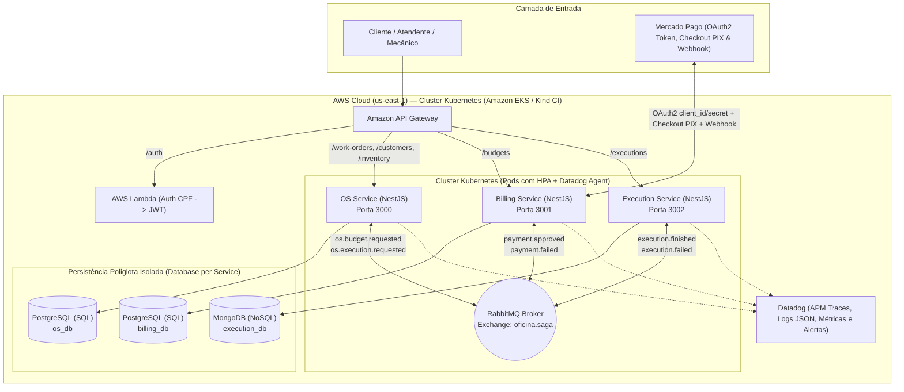

# PÓS-GRADUAÇÃO EM ARQUITETURA DE SOFTWARE · FIAP (SOAT)
# Tech Challenge — Fase 4
**Sistema de Gestão de Oficina Mecânica — Arquitetura de Microsserviços, Persistência Poliglota e Saga Pattern**

---

## 1. Identificação

| Campo | Informação |
| :--- | :--- |
| **Integrante** | Vladmir Musa Costa Bravo |
| **RM** | 374193 |
| **Discord** | `@vladbravo` |
| **Curso** | Pós-graduação em Arquitetura de Software — FIAP (SOAT) |
| **Entrega** | Fase 4 — Tech Challenge |

---

## 2. Links dos Repositórios e Vídeo de Demonstração

A solução foi decomposta em microsserviços independentes, cada um com seu próprio repositório, infraestrutura como código (`/infra` em Terraform), manifestos Kubernetes (`/k8s`), banco de dados exclusivo, pipelines de CI/CD com validação de testes/qualidade (SonarQube/SonarCloud), `main` protegida por Pull Request e colaborador `soat-architecture`:

| Componente / Microsserviço | Banco de Dados | Infra & K8s Próprios | Repositório GitHub |
| :--- | :--- | :---: | :--- |
| **1. OS Service (Ordem de Serviço, Clientes, Veículos, Estoque)** | **PostgreSQL (SQL)** (`os_db`) | `/infra` + `/k8s` | `https://github.com/VladMCBravo/tech-challenge-fase4-os-service` |
| **2. Billing Service (Orçamento e Pagamento + Mercado Pago OAuth2/PIX)** | **PostgreSQL (SQL)** (`billing_db`) | `/infra` + `/k8s` | `https://github.com/VladMCBravo/tech-challenge-fase4-billing-service` |
| **3. Execution Service (Fila de Execução e Produção)** | **MongoDB (NoSQL)** (`execution_db`) | `/infra` + `/k8s` | `https://github.com/VladMCBravo/tech-challenge-fase4-execution-service` |
| **4. Function Serverless (Autenticação por CPF → JWT)** | — | Terraform | `https://github.com/VladMCBravo/tech-challenge-fase3-serverless-auth` |
| **5. Infraestrutura Kubernetes & API Gateway (Terraform)** | — | Terraform | `https://github.com/VladMCBravo/tech-challenge-fase3-infra-k8s` |
| **6. Infraestrutura Banco de Dados (Terraform)** | — | Terraform | `https://github.com/VladMCBravo/tech-challenge-fase3-infra-db` |

- **Link do Vídeo de Demonstração (até 15 min):** `<INSERIR_LINK_DO_YOUTUBE_AQUI>`

---

## 3. Diagrama Geral da Arquitetura Final

---

## 4. Justificativa da Divisão dos Microsserviços e Tecnologias Utilizadas

1. **`os-service` (Ordem de Serviço + PostgreSQL SQL):**
   - **Por que separar:** Concentra o domínio cadastral e a abertura/rastreamento da OS, além da reserva de peças em estoque.
   - **Por que SQL (PostgreSQL):** Exige integridade referencial estrita e transações ACID locais na reserva e no estorno de movimentações de estoque (`InventoryItem` + `InventoryMovement` + `WorkOrder`).
2. **`billing-service` (Orçamento e Pagamento + PostgreSQL SQL + Mercado Pago OAuth2/PIX):**
   - **Por que separar:** Isola o contexto financeiro, regras de cobrança, obtenção de token OAuth2 via `client_id` / `client_secret` (`POST /api/budgets/mercadopago/oauth/token`), geração de preferência Checkout Pro / PIX no **Mercado Pago** (com fallback Mock resiliente quando o ambiente de testes externo está indisponível) e recebimento de Webhooks de pagamento.
   - **Por que SQL (PostgreSQL):** Dados financeiros (`budgets` e `payments`) demandam tipagem decimal exata (`Decimal(10,2)`), auditoria transacional e consistência forte.
3. **`execution-service` (Execução e Produção + MongoDB NoSQL):**
   - **Por que separar:** O pátio/chão de oficina possui alta frequência de leituras da fila priorizada e escrita contínua de apontamentos dos mecânicos durante o diagnóstico e o reparo.
   - **Por que NoSQL (MongoDB):** Cada execução é modelada como um documento autocontido (`execution_tasks`) que agrega os itens a executar e a linha do tempo de etapas (`steps[]`), eliminando JOINs e oferecendo alta performance para a fila de produção (`IN_REPAIR > IN_DIAGNOSIS > QUEUED`).

---

## 5. Estratégia Escolhida para o Saga Pattern (Coreografia via RabbitMQ)

Foi adotado o **Saga Pattern Coreografado (Event-Driven Choreography)** utilizando o **RabbitMQ** (`exchange: oficina.saga`, tipo `topic`).

### 5.1 Fluxo de Sucesso (Happy Path)
1. **Abertura e Reserva (`os-service`):** O atendente move a OS diagnosticada para `WAITING_APPROVAL`. O `os-service` reserva o estoque das peças (`DECREASE`) em transação local e publica `os.budget.requested`.
2. **Orçamento, Token OAuth2 e Cobrança (`billing-service`):** Consome `os.budget.requested`, gera o orçamento (`PENDING`), autentica via `client_id` / `client_secret` (`getAccessToken`) e cria a preferência de pagamento/PIX no **Mercado Pago**.
3. **Confirmação de Pagamento (`billing-service` → `os-service` + `execution-service`):** Ao receber confirmação via Webhook do Mercado Pago (`POST /api/budgets/webhook/mercadopago`), o `billing-service` aprova o orçamento/pagamento e publica `payment.approved`.
   - O `os-service` consome `payment.approved`, muda o status da OS para `IN_EXECUTION` e publica `os.execution.requested`.
   - O `execution-service` consome o evento e enfileira a OS no **MongoDB** com status `QUEUED`.
4. **Conclusão (`execution-service` → `os-service`):** Quando o mecânico finaliza o reparo (`PATCH /api/executions/work-order/:id/finish`), o `execution-service` marca `COMPLETED` no MongoDB e publica `execution.finished`. O `os-service` consome o evento e atualiza a OS para `FINISHED`.

### 5.2 Fluxos de Compensação e Rollback (Tratamento de Falhas)
- **Cenário de Falha 1 — Pagamento Recusado no Mercado Pago (`payment.failed`):**
  - O `billing-service` marca o pagamento como `REJECTED` e publica `payment.failed`.
  - **Transação Compensatória (`os-service`):** Consome `payment.failed`, devolve automaticamente a quantidade reservada ao estoque (`InventoryMovementType.REVERSAL`) e altera o status da OS para `CANCELLED`.
- **Cenário de Falha 2 — Impossibilidade Técnica na Execução (`execution.failed`):**
  - O `execution-service` marca a tarefa no MongoDB como `FAILED` e publica `execution.failed`.
  - **Transação Compensatória 1 (`billing-service`):** Consome `execution.failed`, aciona a API de reembolso do Mercado Pago, muda o pagamento para `REFUNDED` e o orçamento para `CANCELLED`.
  - **Transação Compensatória 2 (`os-service`):** Consome `execution.failed`, estorna as peças ao estoque (`REVERSAL`) e altera a OS para `CANCELLED`.

---

## 6. Qualidade, Testes (`> 80%`), BDD, CI/CD e Observabilidade

| Microsserviço | Testes | Cobertura (Jest) | SonarCloud | Destaques |
| :--- | :--- | :---: | :--- | :--- |
| **`os-service`** | 126 unitários + BDD · 11 e2e HTTP | **95,3%** | Quality Gate **Passed** · 87,5% · A/A/A | BDD executável com **jest-cucumber** (Gherkin `work-order-saga.feature`: fluxo completo + rollback) · e2e da API com supertest |
| **`billing-service`** | 20 unitários | **97,4%** | Quality Gate **Passed** · 87,2% · A/A/A | OAuth2 `client_id`/`client_secret` · Checkout/PIX · estorno `REFUNDED` · RabbitMQ |
| **`execution-service`** | 17 unitários | **90,2%** | Quality Gate **Passed** · 82,9% · A/A/A | Fila NoSQL MongoDB · eventos e compensação da Saga · RabbitMQ |

- **CI/CD (GitHub Actions, um pipeline por repositório):** `test-and-quality` (testes com cobertura mínima de 80% como gate do Jest, build e análise **SonarCloud com Quality Gate bloqueante**) → `build-and-deploy` (imagem Docker → cluster Kubernetes **Kind** → `scripts/deploy-k8s.sh`: banco próprio + RabbitMQ, rollout das 2 réplicas, **health checks** com banco e mensageria conectados, Pods/Services/HPA).
- **Repositórios protegidos:** `main` só recebe alterações via **Pull Request**, com `test-and-quality` e `build-and-deploy` como checks obrigatórios e o resultado do SonarCloud comentado no PR.
- **Saga ponta a ponta:** `scripts/saga-e2e.sh` valida, no cluster, o fluxo de sucesso e as duas compensações (pagamento recusado e falha na execução), incluindo reserva e devolução de estoque.
- **Observabilidade (mesma stack da Fase 3 — Datadog):** APM com traces distribuídos entre os 3 serviços (propagação via RabbitMQ), logs JSON correlacionados por `trace_id`, métricas de negócio `oficina.*` (volume de OS, tempo médio por etapa, compensações) e dashboard versionado em `datadog/`.
- **Evidências:** seção 6 do README de cada repositório (SonarCloud, execuções do Actions, deploy no Kubernetes com health checks, PR com checks e proteção da `main`).

> **Deploy automatizado e limitação do AWS Academy:** conforme orientação do Prof. Alex Faiotto, o deploy automatizado é executado pelo próprio pipeline em um cluster Kubernetes **Kind** (gatilhos `push`, `pull_request` e `workflow_dispatch`), com manifests, script de deploy e evidências de Pods, Services, HPA e health checks nos logs de cada execução. Os mesmos manifestos de `/k8s` e a infraestrutura Terraform (`/infra` e repositórios da Fase 3) servem ao Amazon EKS; o ambiente AWS não fica ativo de forma contínua por causa das sessões temporárias e dos créditos do AWS Academy.
